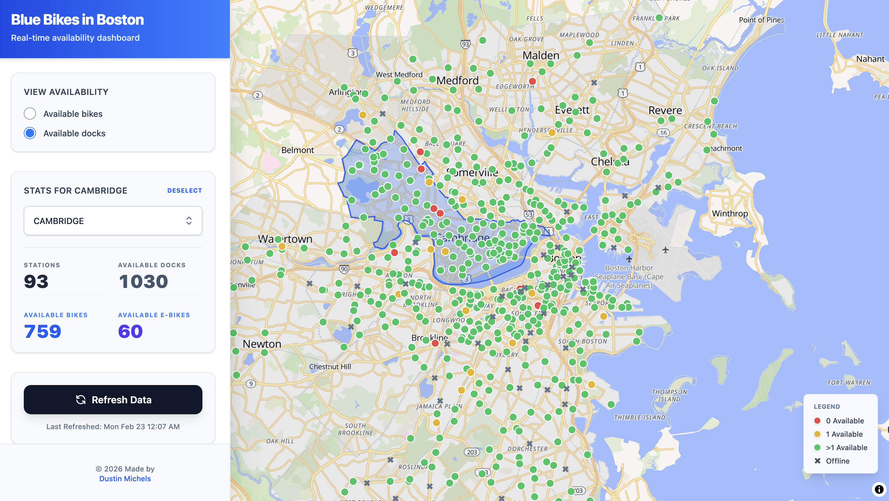

# Creating interactive web apps by leveraging AI

Dustin Michels | Tufts University | Feb 2026

The final product will be similar to this [Blue Bikes Dashboard](https://bluebike.netlify.app/).

[](https://bluebike.netlify.app/)

## Pre-requisites

- Install a code editor: [VSCode](https://code.visualstudio.com/download) or [Zed](https://zed.dev/download)
- Install [Bun](https://bun.sh/)
- _[Optional]_ Install [Bruno](https://www.usebruno.com/downloads)

If on MacOS, you could use the [Homebrew](https://brew.sh/) package manager.

```sh
# install homebrew
/bin/bash -c "$(curl -fsSL https://raw.githubusercontent.com/Homebrew/install/HEAD/install.sh)"

# install bun
brew install oven-sh/bun/bun

# install bruno
brew install --cask bruno

# install VSCode
brew install --cask visual-studio-code
```

In VSCode, I recomend setting up auto-formatting.

- Install the `oxc` extension
- In settings, search for and enable "format on save"
- Also search for "deafult formatter" and set it to oxc

## Contents

- [Part 1: How the web works](/part1_the_web.md)
- [Part 2: Scraping data from the web](/part2_web_scraping.md)
- [Part 3: Building a web app with AI](/part3_vibe_coding.md)
