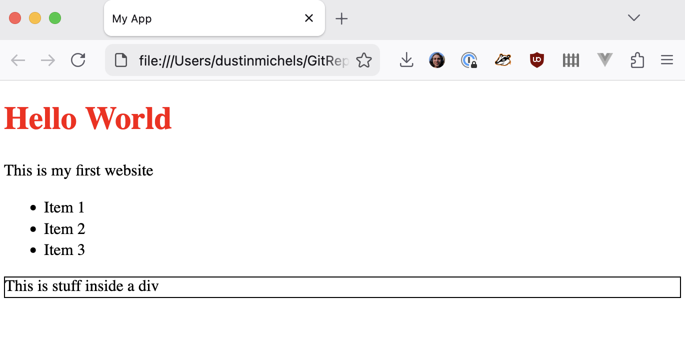
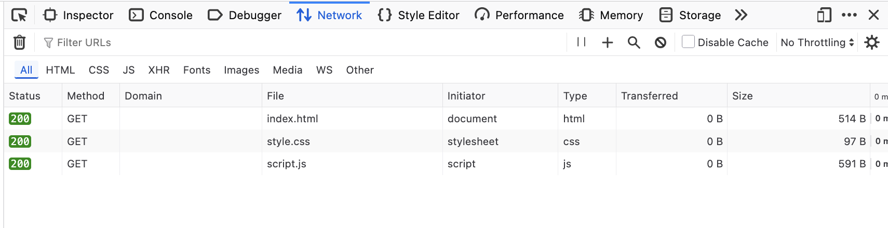

# Part 1: How the web works

## Overview

Web sites are documents made up of HTML, CSS, and JavaScript.

- **HTML** is the structure of the page
- **CSS** adds style
- **JavaScript** adds interactivity
  - **JSON** (_JavaScript Object Notation_) can be used for data


---

A **server** hosts the files that make up a website and serves them to users when they visit the site.

- The server must speak the _HTTP protocol_, which is how browsers communicate with servers.


...Sometimes there is also a database.


---

A **DNS server** translates domain names (like google.com) into IP addresses (like 74.125.224.72) for servers.


## Setup

- Install [Bun](https://bun.sh/). Bun is a JavaScript runtime (like Node.js) that also comes with a package runner, `bunx`, which we'll use to run a local web server.

  ```sh
  # install bun (macOS / Linux)
  curl -fsSL https://bun.sh/install | bash

  # or, with homebrew
  brew install oven-sh/bun/bun

  # check that it worked
  bun --version
  ```

- Create a folder for this project and open it in [VSCode](https://code.visualstudio.com/download).
- _Recommended_
  - Install the "oxc" extension for VSCode
  - Turn on "format on save" in VSCode settings, and configure

Create a folder called "part1":

```sh
# create folder for part 1
mkdir part1

# navigate into part 1
cd part1
```

In this part we'll build four small apps, each in its own folder. By the end, `part1` will look like this:

```txt
part1
├── app1-inline
│   └── index.html
├── app2-files
│   ├── index.html
│   ├── style.css
│   ├── script.js
│   └── data
│       └── colors.json
├── app3-single
│   └── index.html
└── app4-tailwind
    └── index.html
```

| App             | What it shows                                              |
| --------------- | ---------------------------------------------------------- |
| `app1-inline`   | A plain HTML page, styled with inline styles               |
| `app2-files`    | HTML, CSS, JS, and JSON in separate files, served with Bun |
| `app3-single`   | Everything combined into a single HTML file                |
| `app4-tailwind` | A single file that loads a package (Tailwind) from a CDN   |

## App1 - Inline

Make a folder for the app. You can do this by clicking in VSCode, or with terminal commands (from inside `part1`):

```sh
# create app folder
mkdir app1-inline

# navigate into it
cd app1-inline

# create index.html
touch index.html
```

Files:

```txt
part1
└── app1-inline
    └── index.html
```

Create a basic HTML file using "! + tab" in VSCode, or copy and paste the following into `index.html`:

```html
<!doctype html>
<html lang="en">
  <head>
    <meta charset="UTF-8" />
    <meta name="viewport" content="width=device-width, initial-scale=1.0" />
    <title>Document</title>
  </head>
  <body></body>
</html>
```

Open in the browser:

```sh
open index.html
```

_Inside head tag_, try changing title then refresh the page:

```html
<title>My App</title>
```

### Add content (HTML)

_Inside the body tag_, try adding a heading and a paragraph:

```html
<h1>Hello World</h1>
<p>This is my first website</p>
```

You could also add a bulleted list:

```html
<ul>
  <li>Item 1</li>
  <li>Item 2</li>
  <li>Item 3</li>
</ul>
```

You can add a div. A div is a container that can hold other elements.

```html
<div>This is stuff inside a div</div>
```

It doesn't do anything by itself, but it can be used to group elements together and apply styles to them.

### Add inline style

You can style an element directly with the `style` attribute. This is called an _inline style_.

```diff
- <div>This is stuff inside a div</div>
+ <div style="border: 1px solid black">This is stuff inside a div</div>
```

Let's also add an inline style to the header:

```diff
- <h1>Hello World</h1>
+ <h1 style="color: red">Hello World</h1>
```

**Complete code:**

`part1/app1-inline/index.html`

```html
<!doctype html>
<html lang="en">
  <head>
    <meta charset="UTF-8" />
    <meta name="viewport" content="width=device-width, initial-scale=1.0" />
    <title>My App</title>
  </head>
  <body>
    <h1 style="color: red">Hello World</h1>
    <p>This is my first website</p>
    <ul>
      <li>Item 1</li>
      <li>Item 2</li>
      <li>Item 3</li>
    </ul>
    <div style="border: 1px solid black">This is stuff inside a div</div>
  </body>
</html>
```



## App2 - Separate files

Inline styles get messy fast. In this app we'll split the page into separate HTML, CSS, JavaScript, and JSON files.

Make a new folder for the app, and start from a copy of the app1 HTML:

```sh
# go up a directory, back to part1
cd ..

# create app folder
mkdir app2-files

# navigate into it
cd app2-files

# start from a copy of app1's index.html
cp ../app1-inline/index.html index.html
```

Files:

```txt
part1
├── app1-inline
│   └── index.html
└── app2-files
    └── index.html
```

Open it in the browser:

```sh
open index.html
```

### Add style (CSS)

You can separate the style into a css file.

Create a file called `style.css` in the same folder as `index.html`:

```sh
touch style.css
```

Files:

```txt
part1
└── app2-files
    ├── index.html
    └── style.css
```

Back in the `index.html` file, remove the inline style from the h1 element and add a link to the css file:

```diff
  <head>
    (...)
+   <link rel="stylesheet" href="style.css" />
  </head>
  <body>
-   <h1 style="color: red">Hello World</h1>
+   <h1>Hello World</h1>
    (...)
  </body>
```

Then add the following code to `style.css`:

```css
h1 {
  color: red;
}
```

You can use classes to apply styles to certain elements.

Change the html for the div to have a class of "box":

```diff
- <div style="border: 1px solid black">This is stuff inside a div</div>
+ <div class="box">This is stuff inside a div</div>
```

And the css:

```css
.box {
  border: 1px solid black;
  padding: 10px;
}
```

Let's also change the font for all the text on the page:

```css
body {
  font-family: Arial, sans-serif;
}
```

**Code so far:**

<!-- tabs:start -->

#### **HTML**

`part1/app2-files/index.html`

```html
<!doctype html>
<html lang="en">
  <head>
    <meta charset="UTF-8" />
    <meta name="viewport" content="width=device-width, initial-scale=1.0" />
    <title>My App</title>
    <link rel="stylesheet" href="style.css" />
  </head>
  <body>
    <h1>Hello World</h1>
    <p>This is my first website</p>
    <ul>
      <li>Item 1</li>
      <li>Item 2</li>
      <li>Item 3</li>
    </ul>
    <div class="box">This is stuff inside a div</div>
  </body>
</html>
```

#### **CSS**

`part1/app2-files/style.css`

```css
body {
  font-family: Arial, sans-serif;
}

h1 {
  color: red;
}

.box {
  border: 1px solid black;
  padding: 10px;
}
```

<!-- tabs:end -->

Refresh the page. Explore how it looks in the inspector. You can right-click on any element and select "Inspect" or "Inspect Element" to see the HTML and CSS for that element.

### Add functionality (JavaScript)

Create an empty JavaScript file called `script.js` in the same folder as `index.html`:

```sh
touch script.js
```

Files:

```txt
part1
└── app2-files
    ├── index.html
    ├── style.css
    └── script.js
```

In the html file add a button and a link to the javascript file, at the end of the body:

```diff
  <body>
    (...)
+   <button id="myButton">Change header color</button>
+   <script src="script.js"></script>
  </body>
```

The JavaScript will now control the header color, so remove the `h1` rule from `style.css`:

```diff
  body {
    font-family: Arial, sans-serif;
  }

- h1 {
-   color: red;
- }
-
  .box {
    (...)
  }
```

In the `script.js` file, add the following code to change the color of the header when the button is clicked:

```js
// get the button and header elements
const button = document.getElementById("myButton");
const header = document.querySelector("h1");

// make a list of colors
const colors = ["red", "blue", "green", "orange", "purple"];

// create a counter and set it to 0
// set header to the first item in the list
let counter = 0;
header.style.color = colors[counter];

// add a click event listener to the button
button.addEventListener("click", () => {
  // increment the counter
  counter = (counter + 1) % colors.length;
  // change the color of the header
  header.style.color = colors[counter];
});
```

Refresh the page. When you click the button, the color of the header should change.

To understand how this code works, you could run it line by line in the browser console. Open the console by right-clicking on the page and selecting "Inspect" or "Inspect Element", then go to the "Console" tab.

Also, check out the "Network" tab in the inspector. Refresh the page and see how the browser loads the html, css, and js files in three separate HTTP GET requests.



### Introducing JSON

Instead of a list (array) of colors:

```js
const colors = ["red", "blue", "green", "orange", "purple"];
```

we could instead have a list of _objects_.

Eg, color name and hex code. You'd also have to update both color-setting lines to get the hex code.

```diff
- const colors = ["red", "blue", "green", "orange", "purple"];
+ const colors = [
+   { name: "red", hex: "#ff0000" },
+   { name: "blue", hex: "#0000ff" },
+   { name: "green", hex: "#00ff00" },
+   { name: "orange", hex: "#ffa500" },
+   { name: "purple", hex: "#800080" },
+ ];

  let counter = 0;
- header.style.color = colors[counter];
+ header.style.color = colors[counter].hex;

  button.addEventListener("click", () => {
    (...)
-   header.style.color = colors[counter];
+   header.style.color = colors[counter].hex;
  });
```

If your data got large, you might pull it out of the code and into a JSON file.

Create a data folder, and inside, a file called `colors.json`:

```sh
mkdir data
touch data/colors.json
```

Files:

```txt
part1
└── app2-files
    ├── index.html
    ├── style.css
    ├── script.js
    └── data
        └── colors.json
```

Add the data to it:

`part1/app2-files/data/colors.json`

```json
{
  "colors": [
    { "name": "red", "hex": "#ff0000" },
    { "name": "blue", "hex": "#0000ff" },
    { "name": "green", "hex": "#00ff00" },
    { "name": "orange", "hex": "#ffa500" },
    { "name": "purple", "hex": "#800080" }
  ]
}
```

> [!NOTE]
> This is basically tabular data. You can find [CSV-to-JSON converters](https://jsonlint.com/csv-to-json) online.

Now we could update our code to fetch the data from the JSON file instead of having it hardcoded in the JavaScript.

`part1/app2-files/script.js`

```js
const button = document.getElementById("myButton");
const header = document.querySelector("h1");

let colors = [];
let counter = 0;

fetch("data/colors.json")
  .then((response) => response.json())
  .then((data) => {
    colors = data.colors.map((c) => c.hex);
    header.style.color = colors[counter];
  });

button.addEventListener("click", () => {
  if (!colors.length) return;
  counter = (counter + 1) % colors.length;
  header.style.color = colors[counter];
});
```

### Run a local server (Bun)

> [!WARNING]
> `open index.html` doesn't work anymore, because the browser won't let `fetch` read files straight from your filesystem. We need a server.

Rather than `open index.html`, we need to run a local server to serve the files. With Bun installed, run this from inside `app2-files`:

```sh
bunx serve .
```

`bunx` downloads and runs the [serve](https://www.npmjs.com/package/serve) package, which serves every file in the current folder (`.`) over HTTP. Open the URL it prints (usually <http://localhost:3000>). Press `Ctrl + C` to stop the server.

Check the "Network" tab again: now there is a fourth request, for `data/colors.json`.

**Complete code:**

<!-- tabs:start -->

#### **HTML**

`part1/app2-files/index.html`

```html
<!doctype html>
<html lang="en">
  <head>
    <meta charset="UTF-8" />
    <meta name="viewport" content="width=device-width, initial-scale=1.0" />
    <title>My App</title>
    <link rel="stylesheet" href="style.css" />
  </head>
  <body>
    <h1>Hello World</h1>
    <p>This is my first website</p>
    <ul>
      <li>Item 1</li>
      <li>Item 2</li>
      <li>Item 3</li>
    </ul>
    <div class="box">This is stuff inside a div</div>
    <button id="myButton">Change header color</button>
    <script src="script.js"></script>
  </body>
</html>
```

#### **CSS**

`part1/app2-files/style.css`

```css
body {
  font-family: Arial, sans-serif;
}

.box {
  border: 1px solid black;
  padding: 10px;
}
```

#### **JavaScript**

`part1/app2-files/script.js`

```js
const button = document.getElementById("myButton");
const header = document.querySelector("h1");

let colors = [];
let counter = 0;

fetch("data/colors.json")
  .then((response) => response.json())
  .then((data) => {
    colors = data.colors.map((c) => c.hex);
    header.style.color = colors[counter];
  });

button.addEventListener("click", () => {
  if (!colors.length) return;
  counter = (counter + 1) % colors.length;
  header.style.color = colors[counter];
});
```

#### **JSON**

`part1/app2-files/data/colors.json`

```json
{
  "colors": [
    { "name": "red", "hex": "#ff0000" },
    { "name": "blue", "hex": "#0000ff" },
    { "name": "green", "hex": "#00ff00" },
    { "name": "orange", "hex": "#ffa500" },
    { "name": "purple", "hex": "#800080" }
  ]
}
```

<!-- tabs:end -->

## App3 - Single file

You can combine html, css, and js into a single file. This will make it easier to work with simple AI chat bots like ChatGPT that can't read/write multiple files.

Make a new folder for the app:

```sh
# go up a directory, back to part1
cd ..

# create app folder
mkdir app3-single

# navigate into it
cd app3-single

# create index.html
touch index.html
```

Files:

```txt
part1
├── app1-inline
├── app2-files
└── app3-single
    └── index.html
```

To combine, put the CSS code in a `<style>` tag in the head, and the JS code in a `<script>` tag at the end of the body. I removed the JSON file and just hardcoded the data in the JavaScript for simplicity.

Because nothing is fetched, `open index.html` works again (`bunx serve .` works too).

**Complete code:**

`part1/app3-single/index.html`

```html
<!doctype html>
<html lang="en">
  <head>
    <meta charset="UTF-8" />
    <meta name="viewport" content="width=device-width, initial-scale=1.0" />
    <title>My App</title>
    <style>
      body {
        font-family: Arial, sans-serif;
      }

      .box {
        border: 1px solid black;
        padding: 10px;
      }
    </style>
  </head>
  <body>
    <h1>Hello World</h1>
    <p>This is my first website</p>
    <ul>
      <li>Item 1</li>
      <li>Item 2</li>
      <li>Item 3</li>
    </ul>
    <div class="box">This is stuff inside a div</div>
    <button id="myButton">Change header color</button>
    <script>
      const button = document.getElementById("myButton");
      const header = document.querySelector("h1");

      const colors = [
        { name: "red", hex: "#ff0000" },
        { name: "blue", hex: "#0000ff" },
        { name: "green", hex: "#00ff00" },
        { name: "orange", hex: "#ffa500" },
        { name: "purple", hex: "#800080" },
      ];

      let counter = 0;
      header.style.color = colors[counter].hex;

      button.addEventListener("click", () => {
        counter = (counter + 1) % colors.length;
        header.style.color = colors[counter].hex;
      });
    </script>
  </body>
</html>
```

## App4 - Tailwind

Packages can add functionality to your project without you having to write it yourself. For example, [TailwindCSS](https://tailwindcss.com/) is a popular CSS framework that provides pre-built styles and components.

Make a new folder for the app:

```sh
# go up a directory, back to part1
cd ..

# create app folder
mkdir app4-tailwind

# navigate into it
cd app4-tailwind

# create index.html
touch index.html
```

Files:

```txt
part1
├── app1-inline
├── app2-files
├── app3-single
└── app4-tailwind
    └── index.html
```

### Add a package

The tailwind package can be added with a simple script tag in the head of your html file:

```html
<script src="https://cdn.tailwindcss.com"></script>
```

CDN stands for Content Delivery Network. It's a way to load packages from a remote server instead of having to install them locally. This is useful for simple projects or when you just want to quickly test something out.

If you want to install packages while keeping to a single file, look for the "CDN" option in their documentation.

With Tailwind, you style elements by adding classes like `text-4xl` or `bg-slate-50` directly in the HTML, instead of writing your own CSS.

I asked Gemini to generate a version of the page that uses Tailwind for styling instead of custom CSS. Here's the result.

**Complete code:**

`part1/app4-tailwind/index.html`

```html
<!doctype html>
<html lang="en">
  <!--HEAD SECTION -->
  <head>
    <meta charset="UTF-8" />
    <meta name="viewport" content="width=device-width, initial-scale=1.0" />
    <title>My App</title>

    <!--Tailwind gets loaded up here-->
    <script src="https://cdn.tailwindcss.com"></script>
  </head>

  <!--BODY SECTION -->
  <body class="bg-slate-50 min-h-screen flex items-center justify-center p-6 text-slate-800">
    <div
      class="max-w-md w-full bg-white rounded-2xl shadow-xl p-8 space-y-6 border border-slate-100"
    >
      <!--Here's that header 1, wrapped in a DIV-->
      <header class="text-center">
        <h1 class="text-4xl font-extrabold tracking-tight transition-colors duration-300">
          Hello World
        </h1>
        <p class="mt-2 text-slate-500 font-medium">This is my first website</p>
      </header>

      <hr class="border-slate-100" />

      <!--List of items -->
      <ul class="space-y-2">
        <li class="flex items-center space-x-3 p-2 bg-slate-50 rounded-lg border border-slate-100">
          <span class="h-2 w-2 bg-slate-400 rounded-full"></span>
          <span>Item 1</span>
        </li>
        <li class="flex items-center space-x-3 p-2 bg-slate-50 rounded-lg border border-slate-100">
          <span class="h-2 w-2 bg-slate-400 rounded-full"></span>
          <span>Item 2</span>
        </li>
        <li class="flex items-center space-x-3 p-2 bg-slate-50 rounded-lg border border-slate-100">
          <span class="h-2 w-2 bg-slate-400 rounded-full"></span>
          <span>Item 3</span>
        </li>
      </ul>

      <!--Here's that div -->
      <div
        class="p-4 bg-indigo-50 border-2 border-indigo-100 rounded-xl text-indigo-700 text-sm font-medium text-center italic"
      >
        This is stuff inside a div
      </div>

      <!--Here's the button -->
      <button
        id="myButton"
        class="w-full py-3 px-6 bg-slate-900 hover:bg-slate-800 text-white font-semibold rounded-xl shadow-lg transform active:scale-[0.98] transition-all"
      >
        Change header color
      </button>
    </div>

    <!--SCRIPT SECTION -->
    <script>
      const button = document.getElementById("myButton");
      const header = document.querySelector("h1");

      // Using a JS Object instead of a JSON file
      const colors = [
        { name: "red", hex: "#ef4444" }, // Tailwind red-500
        { name: "blue", hex: "#3b82f6" }, // Tailwind blue-500
        { name: "green", hex: "#22c55e" }, // Tailwind green-500
        { name: "orange", hex: "#f97316" }, // Tailwind orange-500
        { name: "purple", hex: "#a855f7" }, // Tailwind purple-500
      ];

      let counter = 0;
      header.style.color = colors[counter].hex;

      // Here's javascript that does something when button is clicked
      button.addEventListener("click", () => {
        counter = (counter + 1) % colors.length;
        header.style.color = colors[counter].hex;
      });
    </script>
  </body>
</html>
```
